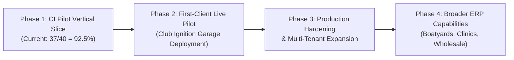

# STARQ ERP — Development Progress & Architecture

> **Multi-Tenant Commercial ERP & Operational Management System for Maldives SMEs**  
> *Sourced canonically from StarqNexus Governance & Duty Roster.*

---

## 📊 Current Status & Engineering Metrics

| Metric | Status | Evidence Source |
|---|---|---|
| **Overall Engineering Progress** | **117 / 264 Tasks Complete (44.3%)** | `starqNexus/data/starq-erp-tasks.json` (All project epics) |
| **CI Pilot Readiness** | **37 / 40 Tasks Complete (92.5%)** | `starqNexus/data/starq-erp-tasks.json` (CI Pilot vertical slice) |
| **Active Engineering WIP** | **0 Tasks** | Strict WIP=0 Gate Discipline |
| **Contract & Boundary Tests** | **175 / 175 PASS** | Deno automated test suite (`tests/contract/`) |
| **Web Client Tests** | **121 / 121 PASS (32 Test Files)** | Vitest automated suite (`web/src/test/`) |
| **PostgreSQL RLS Security** | **31 / 31 Public Tables Protected** | 27 RLS + 4 revoked public grants + 0 unprotected |
| **Database Migration Lineage** | **22 Monotonic SQL Migrations (0001–0022)** | Linear dependency validated (`scripts/lint-migrations.mjs`) |
| **Live Database Baseline Backup** | **CLEARED & VERIFIED** | Restored into local PG 17 scratch DB (SERP-020) |
| **Encrypted Offsite Backup** | **HARD GATE CLEARED** | Verified matching SHA256 (`CB9F5F...FB8D23`) on Drive E: (SERP-173) |
| **Remote Repository & CI** | **CLEAN & PROTECTED** | Private repo `github.com/almstq/starqERP` (`main` ruleset enforced, PR-required, dual CI checks) |
| **Last Reconciled** | **`main @ 34a22f6`** | Task #117 baseline · Canonical StarqNexus task board synchronization |

---

## 🧭 Feature Delivery Matrix

### 🟢 Built & Verified
* **Server-Authoritative Command Envelope:** 27 mapped client mutations covering all 24 server-backed commands (`contracts/commands.ts`) enforcing seat matrix permissions, session tenant resolution, and zero trust for caller-supplied tenant/user identities (SERP-166, SERP-167, SERP-178).
* **Statutory Date-Effective Taxation (SERP-122 / SERP-164):** Line tax engine (`calculateLineTax`) resolving effective rate schedules by supply date (0% for unregistered entities, 8% GGST for registered entities) without floating-point drift.
* **Single Source of Financial Truth (DEC-068 / Amendment A2):** Strict boundary between statutory accounting figures and operational metrics.
* **Database Migration Baseline (0001–0022):** 22 applied SQL migrations defining multi-tenant garage jobs, inventory, statutory tax schedules, bank accounts as entities, SoD tracked exceptions, sequential document numbering, composite FK constraints, transactional outbox and audit events (SERP-034, SERP-038).
* **Concurrency-Safe Document Numbering (SERP-176):** Atomic sequence allocation for `INV-`, `EXP-`, `PO-`, and `GRN-` documents with idempotency replay safety.
* **Adversarial Tenant Isolation & Security Suite (SERP-172 / SERP-033):** Proved cross-tenant isolation across SQL queries, object storage paths, global search, and AI prompt context boundaries, hardened against 5 adversarial attack vectors.
* **Multi-Tenant React 19 Web Client (M0-CLIE-001 / M1-ORGS-001):** Full bookkeeping spine connecting React 19 frontend to backend mutation envelope, supporting Starq Tech and Club Ignition tenant switching, automated Trial Balance, P&L, Balance Sheet, and tenant import pack pipeline.
* **Disaster Recovery Baseline (SERP-020 & SERP-173):** Live Supabase backup (`live_pre_0013.dump`) and offsite AES-256 encrypted archive (`.starqvault`) physically verified on external storage prior to production migration rollout.
* **Governance, Observability & CI Safety (SERP-036 / SERP-263):** In-memory rate limiting, structured telemetry, log sanitizer scrubbing sensitive tokens/PII, and GitHub Actions CI workflow enforcing branch protection on `main`.

### 🟡 In Progress (Current WIP)
* *None* — System operating under strict `WIP = 0` gate discipline between tasks.

### ⚪ Planned / Up Next
* **`SERP-125`:** Permissioned publication boundary (private by default, merchant-controlled; vision §19; reserved for Elder review ~28 Aug).
* **`SERP-003`:** R2 pilot evidence: Starq internal and Club Ignition first real-client proof.
* **`SERP-009`:** R2 gate: First-client measured operational evidence.

---

## 🎯 The 3 Remaining CI Pilot Tasks

To achieve **100% CI Pilot Readiness (40/40)**, the following 3 tasks constitute the remaining delivery path:

| Task ID | Component | Priority | Purpose & Acceptance |
|---|---|---|---|
| **`SERP-125`** | Security / Privacy | **P1** | Publication boundary enforcement (all documents private by default; explicit merchant publish gate; reserved for Elder ~28 Aug). |
| **`SERP-003`** | Operational Evidence | **P0** | Verification of first real-client transactions captured from live Club Ignition garage workflow. |
| **`SERP-009`** | Production Gate | **P0** | Final measurement gate: end-to-end operational execution proof under production conditions. |

---

## 🗺️ Development Roadmap



1. **Phase 1: CI Pilot Vertical Slice (Current):** Complete the 40-task vertical slice (37/40 complete) proving end-to-end bookkeeping, tenant isolation, and statutory tax conformance.
2. **Phase 2: First-Client Live Pilot:** Deploy Club Ignition on the production instance for counter intake, job cards, parts inventory, and sales invoicing.
3. **Phase 3: Production Hardening & Multi-Tenant Onboarding:** Onboard second tenant (Starq Technologies internal accounting) and activate automated tenant provisioning pipeline.
4. **Phase 4: Broader ERP Capabilities:** Expand industry presets (marine boatyards, outpatient medical clinics), advanced multi-currency bank reconciliations, and custom workflow stages.

---

## ⚠️ Known Limitations & Intentionally Parked Work

* **Flutter Mobile App Parked (DEC-067):** The legacy Flutter mobile console (`starq-ops-app` / tasks `SERP-028`, `SERP-151`) is parked/frozen under DEC-067 until explicitly resumed. All counter, intake, QC, and seat-banner UX is consolidated directly into the React 19 web client.
* **Local Scratch DB Restoration Scope:** The local baseline restore test was performed against a vanilla PostgreSQL 17 instance. Because the Supabase-specific `supabase_vault` extension is unavailable in vanilla local PostgreSQL, `vault.secrets` was not restored locally. This verified Starq application data and public schema (30 tables), not a full Supabase platform infrastructure DR simulation.
* **Publication Gate (SERP-125):** Public document links are disabled by default until the formal publication boundary gate is reviewed by Elder.

---

## 🏛️ Repository Architecture

```
starqERP/
├── contracts/        # Canonical TypeScript command envelope & statutory tax engine (SSOT)
│   └── commands.ts   # 27 mutation surface map (24 server commands), seat matrix, rules
├── supabase/         # PostgreSQL database layer & Edge API
│   ├── migrations/   # Migrations 0001–0020 (RLS, audit logs, tax schedules, SoD)
│   └── functions/    # Deno Edge Functions (starq-api /api/ops/event)
├── web/              # React 19 + TypeScript + Vite + TailwindCSS multi-tenant client
│   ├── src/app/      # AppShell, routing, navigation
│   ├── src/components# Domain modules (Invoices, Jobs, Expenses, Reports, Inventory)
│   ├── src/context/  # ERPContext state & backend command dispatchers
│   ├── src/lib/      # Pure bookkeeping & financial statements engine
│   └── src/test/     # Vitest unit & integration test suite
├── tests/            # Contract boundary & adversarial security test suites
│   ├── contract/     # Deno contract & document numbering tests
│   └── *.sql / *.py  # SQL isolation probes & seat matrix drift detectors
└── docs/             # Task execution reports (SERP-xxx.md) and architectural decisions
```

---

## 🛠️ Verification & Developer Setup

### Prerequisites
* [Deno](https://deno.land/) (v1.40+)
* [Node.js](https://nodejs.org/) (v20+)
* [Python](https://www.python.org/) (v3.11+)

### Verification Commands

```powershell
# 1. Run Deno Contract & Boundary Test Suite (175 tests)
deno test tests/contract/ --allow-read --no-check

# 2. Run React Web Client Vitest Suite (121 tests, 32 files)
npm run test --prefix web

# 3. Verify Canonical Contract vs Edge Copy Synchronization
node scripts/sync-contract.mjs --check

# 4. Verify Seat Matrix Drift (Python vs TypeScript vs SQL)
python tests/test_seat_matrix.py

# 5. Build Web Application Bundle
cd web; npm install; npm run build
```

---

*Repository is strictly **Private**. Maintained under the Starq Engineering Governance Standard.*
