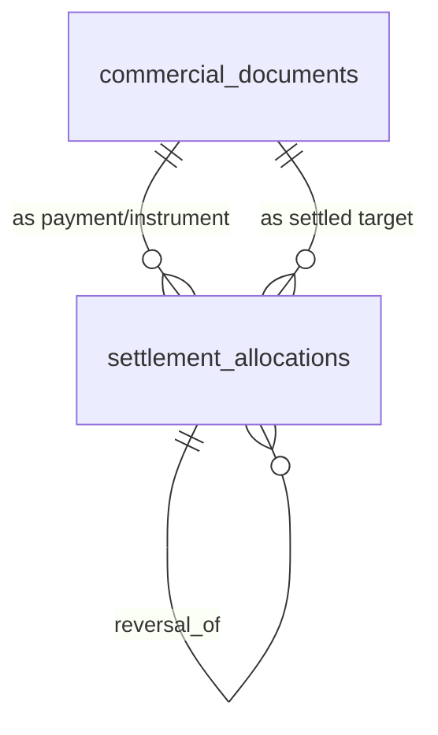

# Architecture Decision Record: DEC-070
## Canonical Payment & Expense Settlement Mapping Architecture & SOP

- **Status:** APPROVED & ADOPTED
- **Authority:** DEC-051 (Single Financial Truth), DEC-068 (Amendment A3), DEC-069 (Gate G6), DEC-072 (Evidence Verification)
- **Task Reference:** SERP-175 / SERP-181
- **Date:** 2026-08-25
- **Author:** Antigravity (`antigravity`) / Verified with Founder (`ali`)

---

## 1. Executive Summary & Problem Statement

Prior naive ERP designs assumed a 1-to-1 relationship between commercial events: every payment was assumed to settle exactly one invoice, and every expense was forced into the structure of a supplier trade bill.

In real-world business and accounting operations in the Maldives, this naive model breaks immediately across **nine foundational accounting realities**. Attempting to fit direct expenses into fictitious supplier accounts produces corrupted trade payables, fictitious vendor master rows, and untraceable bank reconciliations.

This document formalizes the canonical architecture and Standard Operating Procedure (SOP) for all payment, expense, refund, and allocation flows across `starqERP` and `starqBooks`.

---

## 2. The Nine Canonical Accounting Cases & Schema Walkthrough

All flows resolve through two core PostgreSQL tables:
1. `public.commercial_documents` (Headers for Invoices, Bills, Expenses, Payments, Refunds)
2. `public.settlement_allocations` (Many-to-Many Org-Scoped Settlement Bridge with Row-Level Locking)

---

### Case 1: One Invoice Receiving Multiple Payments (Partial Payments)
- **Accounting Reality:** A customer invoice for MVR 10,000 is settled in two installments (e.g., MVR 4,000 on Day 1, MVR 6,000 on Day 7).
- **Schema Mapping:**
  - `commercial_documents`: 1 row `document_type = 'invoice'` (`INV-01`, total = 10,000.00).
  - `commercial_documents`: 2 rows `document_type = 'payment'` (`PAY-01` = 4,000.00, `PAY-02` = 6,000.00).
  - `settlement_allocations`:
    - `(PAY-01, INV-01, allocated_amount: 4000.00)`
    - `(PAY-02, INV-01, allocated_amount: 6000.00)`
- **Derived State:** `get_document_settlement_summary(INV-01)` returns `allocated_total = 10000.00`, `unallocated_balance = 0.00`, status `'fully_settled'`.
- **GL Posting (`starqBooks`):**
  - Installment 1: `Dr Cash/Bank (1001/1002) 4,000.00` / `Cr Accounts Receivable (1200) 4,000.00`
  - Installment 2: `Dr Cash/Bank (1001/1002) 6,000.00` / `Cr Accounts Receivable (1200) 6,000.00`

---

### Case 2: One Payment Settling Multiple Invoices
- **Accounting Reality:** A corporate/fleet client issues a single bank transfer of MVR 10,000 (`PAY-03`) to settle three distinct invoices (`INV-01` MVR 2,000, `INV-02` MVR 3,000, `INV-03` MVR 5,000).
- **Schema Mapping:**
  - `commercial_documents`: 1 row `document_type = 'payment'` (`PAY-03`, total = 10,000.00).
  - `settlement_allocations`:
    - `(PAY-03, INV-01, allocated_amount: 2000.00)`
    - `(PAY-03, INV-02, allocated_amount: 3000.00)`
    - `(PAY-03, INV-03, allocated_amount: 5000.00)`
- **Derived State:** All 3 invoices transition to `'fully_settled'`; `PAY-03` has `unallocated_balance = 0.00`.
- **GL Posting:** `Dr Bank Account (1002) 10,000.00` / `Cr Accounts Receivable (1200) 10,000.00` (sub-ledger split across invoices).

---

### Case 3: Partial Payments (Under-allocation / Balance Due)
- **Accounting Reality:** Customer billed MVR 5,000 (`INV-04`), pays MVR 2,500 (`PAY-04`).
- **Schema Mapping:**
  - `settlement_allocations`: `(PAY-04, INV-04, allocated_amount: 2500.00)`.
- **Derived State:** `INV-04` has `gross_total = 5000.00`, `allocated_total = 2500.00`, `unallocated_balance = 2500.00`, status `'partially_allocated'`.
- **GL Posting:** `Dr Bank 2,500.00` / `Cr Accounts Receivable 2,500.00`. Outstanding AR balance in ledger = MVR 2,500.00.

---

### Case 4: Unallocated Customer Payments on Account (Prepayments & Deposits)
- **Accounting Reality:** Customer pays a deposit of MVR 15,000 (`PAY-05`) before a job quote or invoice is finalized.
- **Schema Mapping:**
  - `commercial_documents`: `PAY-05` created with `document_type = 'payment'`, `status = 'issued'`, gross = 15,000.00. Zero allocation rows initially.
- **Derived State:** `get_document_settlement_summary(PAY-05)` returns `unallocated_balance = 15000.00`, status `'unallocated'`.
- **Subsequent Settlement:** When `INV-05` (MVR 12,000.00) is generated, an allocation is posted (`PAY-05 -> INV-05` for 12,000.00). `PAY-05` retains MVR 3,000.00 unallocated credit on account.
- **GL Posting:**
  - Initial Deposit: `Dr Bank (1002) 15,000.00` / `Cr Customer Advances / Deferred Revenue (2150) 15,000.00`
  - Upon Invoicing & Allocation: `Dr Customer Advances (2150) 12,000.00` / `Cr Accounts Receivable (1200) 12,000.00`

---

### Case 5: Refunds and Credit Note Reversals
- **Accounting Reality:** Customer is credited MVR 1,000 via Credit Note `CN-01`. MVR 600 is allocated to offset invoice `INV-06`, and the remaining MVR 400 is refunded to the customer's bank account via refund instrument `REF-01`.
- **Schema Mapping:**
  - `commercial_documents`: `CN-01` (`document_type = 'customer_credit_note'`, total = 1,000.00).
  - `commercial_documents`: `REF-01` (`document_type = 'refund'`, total = 400.00).
  - `settlement_allocations`:
    - `(CN-01, INV-06, allocated_amount: 600.00)` (Credit note settles invoice)
    - `(REF-01, CN-01, allocated_amount: 400.00)` (Outbound refund settles remaining credit note)
- **Trigger Integrity Rule:** Trigger `assert_settlement_allocation_valid` strictly requires `refund` instruments to settle only `customer_credit_note` documents.
- **GL Posting:**
  - Credit Note: `Dr Sales Returns (4100) 1,000.00` / `Cr Accounts Receivable (1200) 1,000.00`
  - Outbound Refund: `Dr Accounts Receivable (1200) 400.00` / `Cr Bank Account (1002) 400.00`

---

### Case 6: Direct Cash and Card Expenses (No Fictitious Supplier Bill)
- **Accounting Reality:** Workshop technician buys supplies at a store for MVR 150 cash or card on the spot. There is no credit account, no supplier trade invoice, and no ongoing vendor ledger.
- **Schema Mapping:**
  - `commercial_documents`: 1 row `document_type = 'direct_expense'` (`EXP-01`, total = 150.00).
  - Contact is recorded as payee (or generic retail payee); **zero fictitious supplier bills created**.
  - Settled via `settlement_allocations` with payment instrument or direct cash tender.
- **GL Posting:** `Dr Workshop Consumables Expense (5200) 150.00` / `Cr Cash on Hand (1001) or Bank (1002) 150.00`.

---

### Case 7: Petty Cash Vouchers
- **Accounting Reality:** Office petty cash disbursement of MVR 75.00 for office consumables / tea.
- **Schema Mapping:**
  - `commercial_documents`: `document_type = 'petty_cash_voucher'` (`PCV-01`, total = 75.00).
  - Requires custodian seat sign-off.
- **GL Posting:** `Dr Office & Refreshment Expense (5350) 75.00` / `Cr Petty Cash Float (1003) 75.00`.

---

### Case 8: Bank Charges & Fees (Zero Vendor Overhead)
- **Accounting Reality:** Monthly bank maintenance fee (MVR 10.60) or POS merchant processing charge (MVR 300) debited by MIB/BML.
- **Schema Mapping:**
  - `commercial_documents`: `document_type = 'bank_charge'` (`BCH-01`, total = 10.60).
  - Reconciles directly against bank statement reference without supplier bill overhead.
- **GL Posting:** `Dr Bank Charges & Fees (5400) 10.60` / `Cr Bank Account (1002) 10.60`.

---

### Case 9: Supplier Bills Paid Later (Standard Trade Payables)
- **Accounting Reality:** Alia Investments delivers compressor spares on 30-day credit terms on 01 August (`BILL-01`, MVR 8,500). Payment disbursed on 28 August via BML transfer (`PAY-SUP-01`).
- **Schema Mapping:**
  - 01 August: `commercial_documents` row `document_type = 'supplier_bill'`, status `'issued'`.
  - 28 August: `commercial_documents` row `document_type = 'payment'`, status `'issued'`.
  - `settlement_allocations`: `(PAY-SUP-01, BILL-01, allocated_amount: 8500.00)`.
- **GL Posting:**
  - On 01 August: `Dr Spares Inventory (1300) 8,500.00` / `Cr Accounts Payable (2001) 8,500.00`
  - On 28 August: `Dr Accounts Payable (2001) 8,500.00` / `Cr Bank Account (1002) 8,500.00`

---

## 3. Standard Operating Procedure (SOP) for Financial Operations

### 3.1 Operator Workflow Checklist
1. **Always Check Currency Match:** Allocations across different currency codes (e.g. USD payment against MVR invoice) are blocked at the database trigger layer with `currency_mismatch`.
2. **Never Create Fictitious Supplier Bills:** If an expense is direct cash/card, petty cash, or a bank charge, choose the corresponding `document_type` directly.
3. **Handling Overpayments:** Leave excess payment amounts unallocated. They automatically sit on the customer's account as unallocated credit and are available for future invoice settlements.
4. **Reversals:** Never attempt `UPDATE` or `DELETE` on `settlement_allocations`. Direct mutations are rejected by `settlement_allocations_append_only`. Insert an explicit reversal row referencing `reversal_of`.

### 3.2 API & Edge Function Developer Contract
Before writing endpoints for SERP-166 and SERP-167:
1. Wrap all allocation insertions in database transactions.
2. Rely on PostgreSQL trigger `assert_settlement_allocation_valid` for deterministic row locking (`FOR UPDATE` in UUID order) to prevent concurrency races.
3. Always retrieve balances using `app_private.get_document_settlement_summary()` rather than naive client-side sums.

---

## 4. Acceptance & Conformance Sign-Off

This Architecture Decision Record satisfies and closes all acceptance criteria for **SERP-175**:
- [x] All nine cases walked and reconciled against `commercial_documents` and `settlement_allocations`.
- [x] Payment-to-document allocation model settled explicitly with composite org-scoped FKs.
- [x] Non-supplier expense models (`direct_expense`, `petty_cash_voucher`, `bank_charge`) established without fictitious supplier bills.
- [x] Trigger-enforced locking and validation rules verified via synthetic PostgreSQL probe (16/16 suites passed).
- [x] Written decision and SOP filed before SERP-167 endpoint construction.
