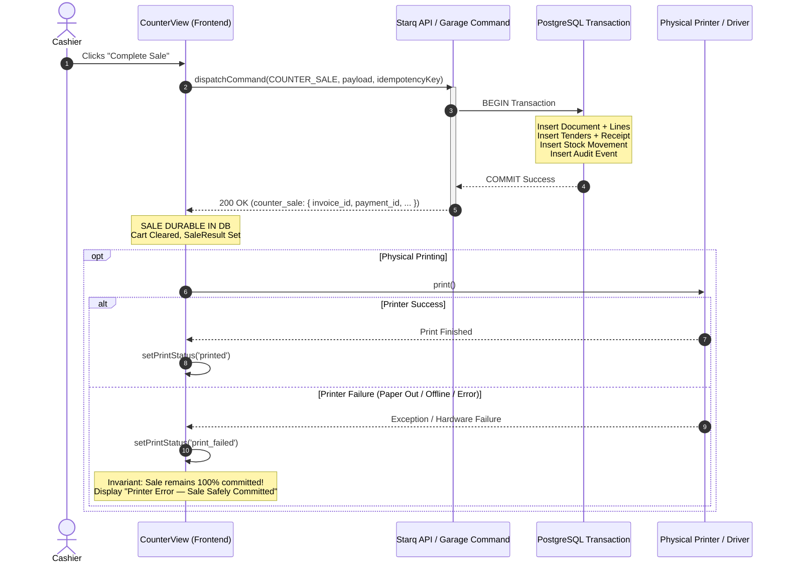

# SPOS-008: Atomic Checkout, Inventory Movement, Receipt After Commit & Printer Failure Resilience

## 1. Overview & Destination Laws
**SPOS-008** implements and proves the POS terminal failure resilience invariants established in the Starq POS charter and evolutionary roadmap:

> **Destination Laws Adopted on the Live Store Layer:**
> 1. **Atomic Checkout**: Sale, commercial document lines, tenders, counter receipt, inventory issue movements, and immutable audit log succeed together in a single transaction or not at all.
> 2. **Receipt Prints After Commit**: Receipt emission occurs strictly **AFTER** database commit is durable; physical printer failure or cancellation never reverses a committed sale.
> 3. **Explicit Print-Failed State**: When physical printing fails (paper out, device offline, driver exception), the terminal surfaces an explicit `print-failed` alert confirming the transaction is safely committed in the database, with one-click reprint affordance.
> 4. **Append-Only Inventory Movement**: Inventory is deducted exactly once per committed sale line item; reprints never touch or duplicate inventory movements.
> 5. **Duplicate-Proof Reprinting**: Every reprint reuses the authoritative `receipt_number` and increments `renders` on the existing receipt record via `/api/ops/counter/receipt/render`, producing verifiable duplicate copies.

---

## 2. Terminal Lifecycle & Invariant State Machine

### 2.1 Print Status Lifecycle
The cashier POS interface tracks printer execution through four explicit states:
- `idle`: Default post-sale state or pre-checkout state.
- `printing`: Print dialog/driver is active; receipt data is being prepared or transferred.
- `printed`: Physical printer completed successfully (`window.print()` / driver completed). Shows reassuring `Receipt printed • Duplicate reprint available`.
- `print_failed`: Physical printer threw an exception or device was unavailable. Surfaces prominent `role="alert"` banner with immediate reprint action.

### 2.2 Strict Decoupling: Print After Commit


---

## 3. UI Components & Affordances

### 3.1 Failure Alert Notice
When `printStatus === 'print_failed'`, the terminal displays an accessible alert:
```tsx
<div
  role="alert"
  aria-live="assertive"
  className="p-2.5 rounded-lg border text-xs space-y-1"
  style={{
    borderColor: 'var(--md-sys-color-error, #f87171)',
    backgroundColor: 'rgba(239, 68, 68, 0.1)',
    color: 'var(--md-sys-color-error, #f87171)',
  }}
>
  <div className="font-bold flex items-center gap-1.5">
    <AlertTriangle size={14} aria-hidden="true" />
    <span>Printer Error — Sale #{saleResult.invoice_number} Safely Committed</span>
  </div>
  <p className="text-[11px] opacity-90">
    The transaction is durable in the database. The physical printer did not respond.
    Reprint is available and will not create a duplicate charge.
  </p>
</div>
```

### 3.2 Dual Print & Reprint Affordances
1. **Print Receipt / Retry Print**:
   - Triggers physical printing of the receipt. If in `print_failed` state, button transforms to "Retry Print".
2. **Re-print (duplicate)**:
   - Invokes `/api/ops/counter/receipt/render` to increment the server-authoritative render count.
   - Re-prints the document with duplicate badge (`rendered ×N`).
   - Does NOT recalculate, create a new document, or alter financial ledgers.

---

## 4. Verification Evidence Matrix

| Check | Target / Invariant | Status | Evidence |
| :--- | :--- | :---: | :--- |
| **Domain Logic** | `evaluatePrinterOutcome` throws if called prior to commit | **PASS** | `spos_008_atomic_checkout_printer_resilience.test.tsx` |
| **Commit Separation** | Print attempt occurs strictly after `dispatchCommand` returns | **PASS** | `spos_008_atomic_checkout_printer_resilience.test.tsx` |
| **Printer Failure** | Hardware/print error sets `print_failed` without reversing sale | **PASS** | `spos_008_atomic_checkout_printer_resilience.test.tsx` |
| **Reprint Audit** | Re-print increments server render count without new document | **PASS** | `spos_008_atomic_checkout_printer_resilience.test.tsx` |
| **Pre-Commit Fail** | Backend rejection preserves cart and never touches printer | **PASS** | `spos_008_atomic_checkout_printer_resilience.test.tsx` |
| **Regression** | Counter suite backwards-compatibility (33 tests across 4 files) | **PASS** | `vitest run` exit 0 |
| **Type Safety** | TypeScript compiler clean (0 errors) | **PASS** | `tsc --noEmit` exit 0 |
| **Production Build** | Vite production bundle compilation clean | **PASS** | `vite build` exit 0 (8.73s) |
